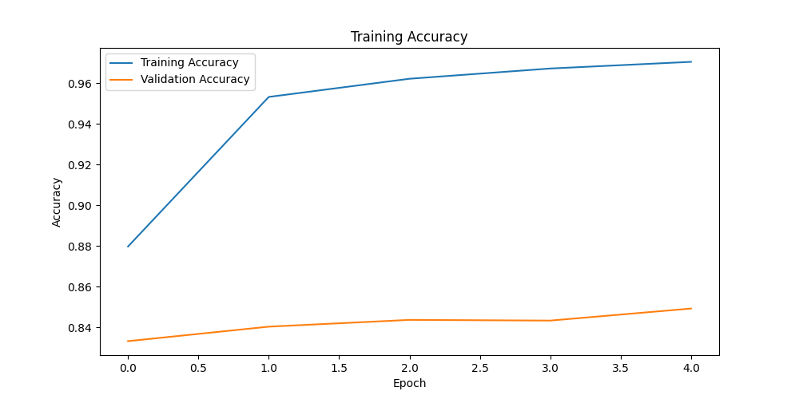
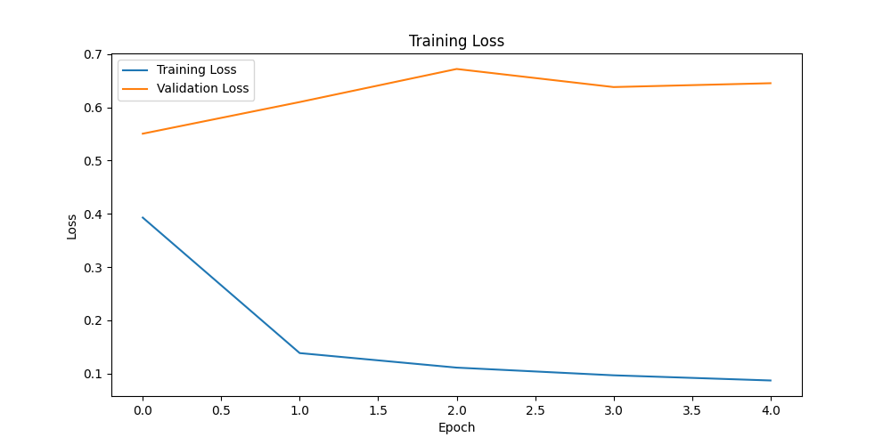

# 🤟 AI Sign Language Translator (Real-Time ASL Recognition)


A real-time Computer Vision and Deep Learning application that translates **American Sign Language (ASL)** hand gestures into text using a live webcam feed. Built with **MediaPipe** for hand landmark detection and a fine-tuned **MobileNetV2** classifier for low-latency gesture recognition.

---

### 🎥 Live Demo & Training Metrics

> **Tip:** Add a short screen recording (`demo.gif`) of your webcam predicting signs into an `assets/` folder so recruiters see it working immediately.

| Training Accuracy Curve | Training Loss Curve |
| :---: | :---: |
|  |  |

---

### 🎯 Problem & Motivation
Communication barriers between deaf/hard-of-hearing individuals and non-signers often require specialized hardware or human interpreters. This project delivers a **lightweight, webcam-only assistive AI tool** capable of recognizing 29 ASL gestures (`A–Z`, `space`, `del`, `nothing`) in real time on standard consumer laptops.

---

### 🏗️ System Pipeline & Architecture

```text
[Webcam Video Stream (OpenCV)]
              │
              ▼
[MediaPipe Hand Landmark Detection] ──► Crops Region of Interest (ROI) + Draws Landmarks
              │
              ▼
[MobileNetV2 Transfer Learning Model]
  ├── Base: MobileNetV2 (Pre-trained on ImageNet)
  ├── GlobalAveragePooling2D
  ├── Dense (256 units, ReLU) + Dropout
  └── Softmax Output Layer (29 Classes)
              │
              ▼
[Real-Time Character & Text Overlay]
```

---

### ✨ Key Features
- **Real-Time Hand Tracking:** Uses MediaPipe to isolate hand regions and render 21 3D hand landmarks with bounding boxes.
- **29-Class Gesture Recognition:** Recognizes all 26 English alphabets (`A–Z`) plus functional controls (`space`, `del`, `nothing`) to form words.
- **Lightweight & Fast Inference:** Powered by MobileNetV2 transfer learning for smooth real-time FPS without heavy GPU requirements.
- **Modular Training Pipeline:** Includes dedicated scripts for preprocessing, custom dataset training, and live inference.

---

### 📊 Dataset & Model Configuration
- **Dataset:** [Kaggle ASL Alphabet Dataset](https://kaggle.com) (29 classes)
- **Loss Function:** Categorical Crossentropy
- **Optimizer:** Adam
- **Saved Artifacts:** `best_model.keras` (checkpoint with lowest validation loss) & `final_model.keras`

---

### 📂 Project Structure

```text
AI-Sign-Language-Translator/
├── dataset/
│   ├── asl_alphabet_train/     # Training images organized across 29 class folders
│   └── asl_alphabet_test/      # Test samples for evaluation
├── models/
│   ├── best_model.keras        # Best validation checkpoint
│   ├── final_model.keras       # Final trained model weights
│   ├── accuracy.png            # Training vs. validation accuracy plot
│   └── loss.png                # Training vs. validation loss plot
├── preprocess.py               # Image resizing, normalization & data pipeline
├── train.py                    # MobileNetV2 transfer learning & model checkpointing
├── predict.py                  # Real-time OpenCV + MediaPipe webcam inference
├── requirements.txt            # Python dependencies
└── README.md
```

---

### ⚙️ How to Run Locally

1. **Clone the repository:**
   ```bash
   git clone https://github.com
   cd AI-Sign-Language-Translator
   ```

2. **Create a virtual environment & install dependencies:**
   ```bash
   python -m venv venv
   source venv/bin/activate        # On Windows: venv\Scripts\activate
   pip install -r requirements.txt
   ```

3. **Run real-time webcam prediction:**
   ```bash
   python predict.py
   ```

4. *(Optional)* **Retrain on custom dataset:**
   ```bash
   python preprocess.py
   python train.py
   ```

---

### 🚀 Roadmap & Future Improvements
- [ ] **Sentence Builder & Text-to-Speech:** Buffer predicted letters into complete words/sentences with audio output (`pyttsx3` / `gTTS`).
- [ ] **Interactive Web UI:** Wrap inference into a **Streamlit** dashboard so users can test gestures directly in the browser.
- [ ] **Dynamic Word-Level Signs:** Extend recognition from static alphabets to motion-based words using LSTM / sequence modeling.

---

### 👩‍💻 Author
**Thoram Sudeeptha**  
B.Tech in Computer Science (AI & ML) — Malla Reddy Engineering College for Women  
[GitHub](https://github.com) • [LinkedIn](https://linkedin.com)

---

### 🙏 Acknowledgements
- [TensorFlow & Keras](https://tensorflow.org) • [Google MediaPipe](https://google.com) • [OpenCV](https://opencv.org) • [Kaggle ASL Alphabet Dataset](https://kaggle.com)
